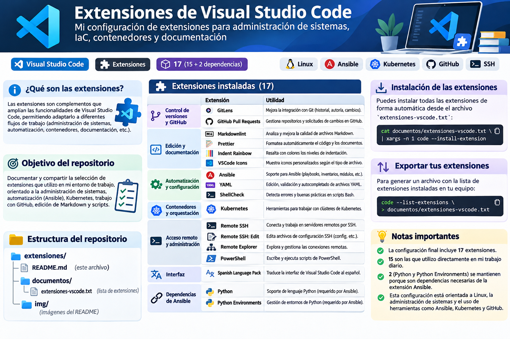

<div align="center">


# 🧩 Mis extensiones de Visual Studio Code

**Una selección de extensiones para trabajar con Linux, administración de sistemas, documentación, GitHub y Kubernetes.**


</div>

## 📖 ¿Qué contiene este repositorio?

Las **extensiones de Visual Studio Code** son complementos que añaden funcionalidades al editor: resaltado y validación de archivos, herramientas de administración remota, integración con Git y GitHub, formateo y soporte para tecnologías específicas.

Este repositorio recoge **17 extensiones instaladas**: 15 seleccionadas para mi trabajo habitual y 2 extensiones de Python que se mantienen porque **Ansible las necesita como dependencias**. No incluye las configuraciones personales de cada extensión.

## 🗂️ Estructura

```text
extensiones/
├── README.md
├── LICENSE
├── documentos/
│   └── extensiones-vscode.txt
└── img/
    ├── banner-vscode.png
    └── resumen-extensiones.png
```

## 🧰 Extensiones instaladas

### 📝 Documentación, edición y apariencia

| Extensión | ¿Para qué sirve? |
|---|---|
| [Markdownlint](https://marketplace.visualstudio.com/items?itemName=DavidAnson.vscode-markdownlint) | Detecta problemas de estilo en documentos Markdown. |
| [Prettier](https://marketplace.visualstudio.com/items?itemName=esbenp.prettier-vscode) | Formatea automáticamente archivos y documentos compatibles. |
| [Indent Rainbow](https://marketplace.visualstudio.com/items?itemName=oderwat.indent-rainbow) | Colorea los niveles de indentación. |
| [VSCode Icons](https://marketplace.visualstudio.com/items?itemName=vscode-icons-team.vscode-icons) | Añade iconos reconocibles a archivos y carpetas. |
| [Spanish Language Pack](https://marketplace.visualstudio.com/items?itemName=MS-CEINTL.vscode-language-pack-es) | Traduce la interfaz de VS Code al español. |

### 🌿 Git y GitHub

| Extensión | ¿Para qué sirve? |
|---|---|
| [GitLens](https://marketplace.visualstudio.com/items?itemName=eamodio.gitlens) | Facilita consultar el historial, autores y cambios de Git. |
| [GitHub Pull Requests](https://marketplace.visualstudio.com/items?itemName=GitHub.vscode-pull-request-github) | Permite revisar y gestionar pull requests e incidencias de GitHub. |

### 🐧 Linux, automatización y Kubernetes

| Extensión | ¿Para qué sirve? |
|---|---|
| [ShellCheck](https://marketplace.visualstudio.com/items?itemName=timonwong.shellcheck) | Ayuda a detectar errores y malas prácticas en scripts de shell. |
| [YAML](https://marketplace.visualstudio.com/items?itemName=redhat.vscode-yaml) | Ofrece validación y asistencia para editar archivos YAML. |
| [Ansible](https://marketplace.visualstudio.com/items?itemName=redhat.ansible) | Proporciona herramientas para editar playbooks y archivos de Ansible. |
| [Kubernetes](https://marketplace.visualstudio.com/items?itemName=ms-kubernetes-tools.vscode-kubernetes-tools) | Facilita el trabajo con recursos y clústeres Kubernetes. |

### 🔐 Administración remota y PowerShell

| Extensión | ¿Para qué sirve? |
|---|---|
| [Remote - SSH](https://marketplace.visualstudio.com/items?itemName=ms-vscode-remote.remote-ssh) | Permite abrir carpetas y trabajar en equipos remotos por SSH. |
| [Remote - SSH: Editing Configuration Files](https://marketplace.visualstudio.com/items?itemName=ms-vscode-remote.remote-ssh-edit) | Facilita la edición de configuraciones SSH. |
| [Remote Explorer](https://marketplace.visualstudio.com/items?itemName=ms-vscode.remote-explorer) | Ayuda a explorar y gestionar destinos remotos. |
| [PowerShell](https://marketplace.visualstudio.com/items?itemName=ms-vscode.powershell) | Ofrece soporte para escribir y depurar scripts PowerShell. |

### 🔗 Dependencias de Ansible

| Extensión | Motivo por el que se conserva |
|---|---|
| [Python](https://marketplace.visualstudio.com/items?itemName=ms-python.python) | Dependencia requerida por la extensión Ansible instalada. |
| [Python Environments](https://marketplace.visualstudio.com/items?itemName=ms-python.vscode-python-envs) | Dependencia requerida por la extensión Ansible instalada. |

> [!NOTE]
> Aunque actualmente no utilizo VS Code para programar en Python, mantengo estas dos extensiones porque VS Code indica que **Ansible depende de ellas**.

## 🚀 Instalar las extensiones en otro equipo

### Requisitos

- Tener **Visual Studio Code** instalado.
- Disponer del comando `code` en la terminal y de conexión a Internet.
- Ejecutar los siguientes comandos desde la **raíz del repositorio**.

**1. Clonar el repositorio** (sustituye `TU_USUARIO` por tu usuario de GitHub):

```bash
git clone https://github.com/TU_USUARIO/extensiones.git
cd extensiones
```

**2. Instalar las extensiones incluidas en la lista:**

```bash
xargs -r -n 1 code --install-extension < documentos/extensiones-vscode.txt
```

**3. Comprobar las extensiones instaladas:**

```bash
code --list-extensions
```

> [!TIP]
> La lista incluye los identificadores de las extensiones, **no sus versiones exactas**. Al restaurarla, normalmente se descargan las versiones disponibles en ese momento. Algunas funciones también requieren programas externos, como `shellcheck`, `ansible` o `kubectl`.

## 📤 Exportar las extensiones de tu VS Code

Para actualizar el listado con las extensiones instaladas en tu equipo, ejecuta desde la raíz del repositorio:

```bash
code --list-extensions > documentos/extensiones-vscode.txt
```

Para contar las extensiones:

```bash
code --list-extensions | wc -l
```

Si quieres guardar también las versiones instaladas, puedes generar **otro archivo**:

```bash
code --list-extensions --show-versions > documentos/extensiones-con-versiones.txt
```

## 🖼️ Resumen visual



## ℹ️ Notas

- La selección está orientada a **Linux y administración de sistemas**.
- No es necesario instalar todas las extensiones para utilizar VS Code.
- Este repositorio permite reproducir la **lista de extensiones**, pero no guarda automáticamente ajustes personales, credenciales ni proyectos.
- Los distintivos de [Shields.io](https://shields.io/) son decorativos y se cargan desde Internet.

---

<div align="center">

**Hecho para documentar y compartir un entorno de trabajo con Visual Studio Code.** 💙

</div>
