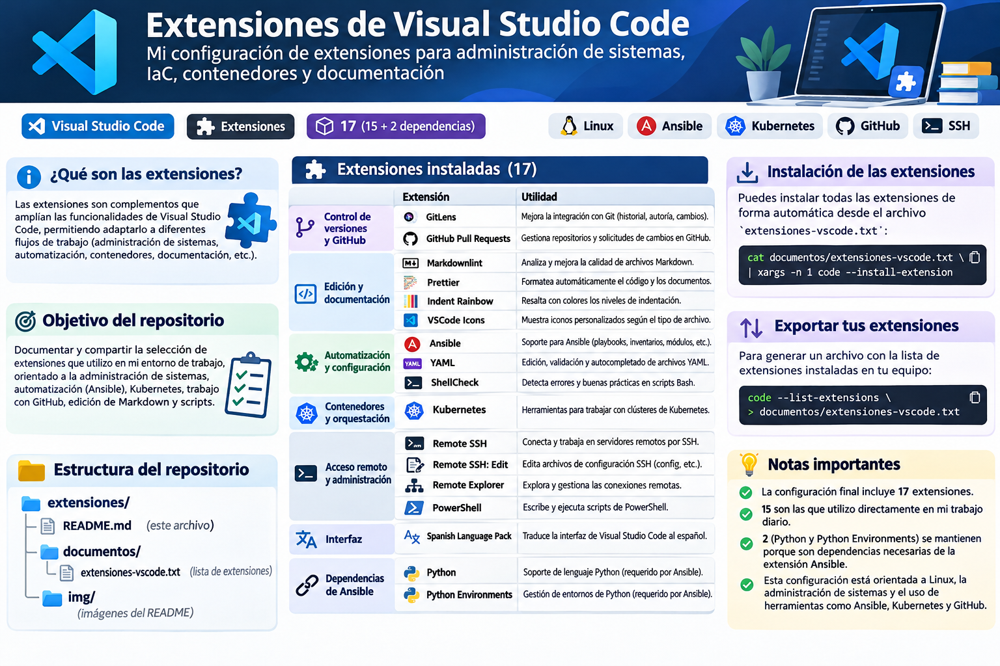

# 🧩 Mis extensiones de Visual Studio Code

**Una selección de extensiones para trabajar con Linux, administración de sistemas, documentación, GitHub y Kubernetes.**


## 📖 ¿Qué contiene este repositorio?

Las **extensiones de Visual Studio Code** son complementos que añaden funcionalidades al editor: resaltado y validación de archivos, herramientas de administración remota, integración con Git y GitHub, formateo y soporte para tecnologías específicas.

Este repositorio recoge **17 extensiones en la lista de instalación**: 15 seleccionadas para mi trabajo habitual y 2 extensiones de Python que se mantienen porque **Ansible las necesita como dependencias**. No incluye las configuraciones personales de cada extensión.

## 🗂️ Estructura

```text
extensiones/
├── README.md
├── LICENSE
├── documentos/
│   └── extensiones-vscode.txt
└── img/
    ├── banner-vscode.png
    └── resumen-extensiones.png
```

## 🧰 Extensiones instaladas

### 📝 Documentación, edición y apariencia

| Extensión | ¿Para qué sirve? |
|---|---|
| [Markdownlint](https://marketplace.visualstudio.com/items?itemName=DavidAnson.vscode-markdownlint) | Detecta problemas de estilo en documentos Markdown. |
| [Prettier](https://marketplace.visualstudio.com/items?itemName=esbenp.prettier-vscode) | Formatea automáticamente archivos y documentos compatibles. |
| [Indent Rainbow](https://marketplace.visualstudio.com/items?itemName=oderwat.indent-rainbow) | Colorea los niveles de indentación. |
| [VSCode Icons](https://marketplace.visualstudio.com/items?itemName=vscode-icons-team.vscode-icons) | Añade iconos reconocibles a archivos y carpetas. |
| [Spanish Language Pack](https://marketplace.visualstudio.com/items?itemName=MS-CEINTL.vscode-language-pack-es) | Traduce la interfaz de VS Code al español. |

### 🌿 Git y GitHub

| Extensión | ¿Para qué sirve? |
|---|---|
| [GitLens](https://marketplace.visualstudio.com/items?itemName=eamodio.gitlens) | Facilita consultar el historial, autores y cambios de Git. |
| [GitHub Pull Requests](https://marketplace.visualstudio.com/items?itemName=GitHub.vscode-pull-request-github) | Permite revisar y gestionar pull requests e incidencias de GitHub. |

### 🐧 Linux, automatización y Kubernetes

| Extensión | ¿Para qué sirve? |
|---|---|
| [ShellCheck](https://marketplace.visualstudio.com/items?itemName=timonwong.shellcheck) | Ayuda a detectar errores y malas prácticas en scripts de shell. |
| [YAML](https://marketplace.visualstudio.com/items?itemName=redhat.vscode-yaml) | Ofrece validación y asistencia para editar archivos YAML. |
| [Ansible](https://marketplace.visualstudio.com/items?itemName=redhat.ansible) | Proporciona herramientas para editar playbooks y archivos de Ansible. |
| [Kubernetes](https://marketplace.visualstudio.com/items?itemName=ms-kubernetes-tools.vscode-kubernetes-tools) | Facilita el trabajo con recursos y clústeres Kubernetes. |

### 🔐 Administración remota y PowerShell

| Extensión | ¿Para qué sirve? |
|---|---|
| [Remote - SSH](https://marketplace.visualstudio.com/items?itemName=ms-vscode-remote.remote-ssh) | Permite abrir carpetas y trabajar en equipos remotos por SSH. |
| [Remote - SSH: Editing Configuration Files](https://marketplace.visualstudio.com/items?itemName=ms-vscode-remote.remote-ssh-edit) | Facilita la edición de configuraciones SSH. |
| [Remote Explorer](https://marketplace.visualstudio.com/items?itemName=ms-vscode.remote-explorer) | Ayuda a explorar y gestionar destinos remotos. |
| [PowerShell](https://marketplace.visualstudio.com/items?itemName=ms-vscode.powershell) | Ofrece soporte para escribir y depurar scripts PowerShell. |

### 🤖 Extensiones de IA

| Extensión | Compañía | ¿Para qué sirve? |
|---|---|---|
| [GitHub Copilot](https://marketplace.visualstudio.com/items?itemName=GitHub.copilot) | GitHub | Sugiere código mientras escribes y ofrece ayuda desde el chat de VS Code. |
| [Codex](https://marketplace.visualstudio.com/items?itemName=openai.chatgpt) | OpenAI | Analiza archivos del proyecto, propone cambios y puede ejecutar comandos y pruebas. |
| [Google Antigravity](https://marketplace.visualstudio.com/items?itemName=google.google-antigravity) | Google | Permite trabajar con un agente basado en Gemini para planificar tareas y realizar cambios en el proyecto. |
| [Claude Code](https://marketplace.visualstudio.com/items?itemName=anthropic.claude-code) | Anthropic | Permite consultar a Claude sobre el proyecto, revisar sus propuestas de cambio y ejecutar comandos desde VS Code. |

### 🔗 Dependencias de Ansible

| Extensión | Motivo por el que se conserva |
|---|---|
| [Python](https://marketplace.visualstudio.com/items?itemName=ms-python.python) | Dependencia requerida por la extensión Ansible instalada. |
| [Python Environments](https://marketplace.visualstudio.com/items?itemName=ms-python.vscode-python-envs) | Dependencia requerida por la extensión Ansible instalada. |

> [!NOTE]
> Aunque actualmente no utilizo VS Code para programar en Python, mantengo estas dos extensiones porque VS Code indica que **Ansible depende de ellas**.

## 📦 Exportar e importar extensiones de VS Code

Para exportar la lista o instalar las extensiones, necesitas que el comando `code` esté disponible en tu terminal.

### 1. Exportar extensiones instaladas

Abre una terminal en la carpeta donde quieras guardar tu lista.

**Windows (PowerShell)**

```powershell
code --list-extensions | Set-Content -Encoding ASCII extensiones-vscode.txt
```

**Ubuntu y otras distribuciones Linux (Bash)**

```bash
code --list-extensions > extensiones-vscode.txt
```

Copia el archivo `extensiones-vscode.txt` al otro ordenador.

### 2. Importar extensiones

Abre una terminal en la carpeta donde guardaste `extensiones-vscode.txt`. Puedes usar tu propia lista exportada o la del profesor.

**Windows (PowerShell)**

```powershell
Get-Content .\extensiones-vscode.txt | ForEach-Object { code --install-extension $_ }
```

**Ubuntu y otras distribuciones Linux (Bash)**

```bash
xargs -r -n 1 code --install-extension < extensiones-vscode.txt
```

Para comprobar las extensiones instaladas, ejecuta `code --list-extensions`.

### 3. Descargar las extensiones del profesor

Abre [extensiones-vscode.txt en GitHub](https://github.com/mftienda/VScode/blob/main/documentos/extensiones-vscode.txt) y pulsa el icono de descarga (↓) arriba a la derecha del archivo. Después, sigue el paso 2 para instalar las extensiones de la lista.

También puedes descargar la lista desde la terminal, en la carpeta donde quieras guardarla.

**Windows (PowerShell)**

```powershell
Invoke-WebRequest -UseBasicParsing -Uri 'https://raw.githubusercontent.com/mftienda/VScode/main/documentos/extensiones-vscode.txt' -OutFile 'extensiones-vscode.txt'
```

**Ubuntu y otras distribuciones Linux (Bash con `curl`)**

```bash
curl -fL https://raw.githubusercontent.com/mftienda/VScode/main/documentos/extensiones-vscode.txt -o extensiones-vscode.txt
```

## ☁️ Sincronización de VS Code

La sincronización de VS Code permite recuperar tus ajustes, extensiones, atajos de teclado y la distribución de los paneles en otro ordenador.

1. En el ordenador actual, abre el menú de **Cuentas** (el icono de perfil, abajo a la izquierda) y selecciona **Configuración de copia de seguridad y sincronización…**.
2. Si VS Code te pide una cuenta, elige **GitHub** e inicia sesión. Marca **Configuración**, **Extensiones** y **Estado de la interfaz** para recuperar también la ubicación de pestañas como Codex y Antigravity. Si utilizas perfiles, marca **Perfiles**.
3. En el otro ordenador, instala VS Code y activa la sincronización con la **misma cuenta**. VS Code recuperará los ajustes seleccionados e instalará las extensiones.

La copia se guarda en el servicio de sincronización de VS Code. La cuenta de GitHub sirve para identificarte y no se crea ningún repositorio.

Al abrir Codex, Antigravity o Claude Code en el nuevo equipo, puede que tengas que iniciar sesión de nuevo. Para llevarte también tus proyectos, copia sus carpetas o clona sus repositorios.

[Guía oficial de sincronización de VS Code](https://code.visualstudio.com/docs/configure/settings-sync)

## 🖼️ Resumen visual



## ℹ️ Notas

- La selección está orientada a **Linux y administración de sistemas**.
- No es necesario instalar todas las extensiones para utilizar VS Code.
- Este repositorio permite reproducir la **lista de extensiones**, pero no guarda automáticamente ajustes personales, credenciales ni proyectos.
- Los distintivos de [Shields.io](https://shields.io/) son decorativos y se cargan desde Internet.

---

<div align="center">

**Hecho para documentar y compartir un entorno de trabajo con Visual Studio Code.** 💙

</div>
